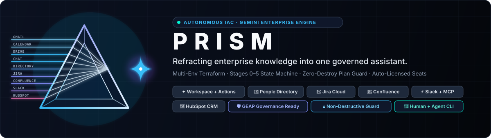
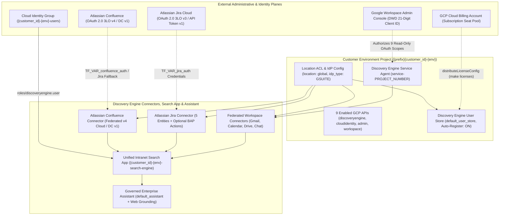
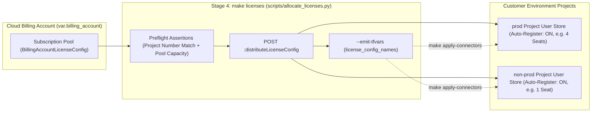
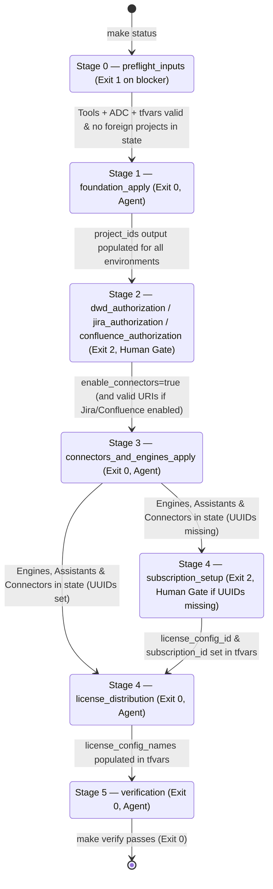

<div align="center">
  
</div>

# Prism — Gemini Enterprise Customer Provisioning: Deployment Requirements & Practitioner's Guide

**Document Status:** Production Reference | **Repository:** [pedroccorreia/gemini-prism](https://github.com/pedroccorreia/gemini-prism) | **Target Stack:** Google Cloud Discovery Engine (Gemini Enterprise), Google Workspace, Atlassian Jira Cloud, Terraform IaC (`>= 1.5.0`)

> **Executive Summary:** This document is the authoritative end-to-end engineering asset for deploying **Prism: Gemini Enterprise (Vertex AI Search)** across isolated customer environments (`non-prod`, `prod`, `dev`, `pilot`, `staging`). **Part I** specifies every technical, identity, IAM, licensing, network, and third-party tenant requirement needed to deploy successfully on the first run. **Part II** provides a complete **Practitioner's Guide** detailing how to operate every Terraform module, Python automation tool, safety guard, `Makefile` target, autonomous agent hand-off gate, and Day-2 operational workflow in the repository.

## Part I: Complete Deployment Requirements & Readiness Specification

### 1. Target Architecture & Provisioned Resource Footprint

The **Prism** Infrastructure-as-Code (IaC) stack automates the creation of dedicated Google Cloud environment projects, configures Google Workspace (`GSUITE`) location-level identity and access control, wires real-time federated Google Workspace connectors alongside multi-entity Atlassian Jira and federated Confluence connectors, provisions a unified Intranet Search Engine and Governed Enterprise Assistant, and distributes Gemini Enterprise seat licenses from a central Cloud Billing Account pool.



#### Core Architectural Invariants

1. **Mandatory `global` Location for Workspace & Confluence Federation:** The `location` variable defaults to `"global"`. Google Workspace connectors (`google_mail`, `google_calendar`, `google_drive`, `google_chat`) and Atlassian Confluence connectors operate in `FEDERATED` mode (`refresh_interval = "0s"`). Queries execute in real time against Google Workspace and Confluence APIs under the end-user's OAuth identity without copying content into persistent GCP storage. Discovery Engine requires the `global` location for federated collections.
2. **Staged Provisioning Across Human Authorization Gates:** The Google-managed Discovery Engine Service Agent (`service-<PROJECT_NUMBER>@gcp-sa-discoveryengine.iam.gserviceaccount.com`) does not exist until the customer GCP project is created and `discoveryengine.googleapis.com` service identity generation is invoked. Consequently, provisioning is decoupled into **Stage 1 (Foundation Apply)** and **Stage 3 (Connectors, Engines & Assistants Apply)**, separated by **Stage 2 (Human Admin Authorization Gate)** so Domain-Wide Delegation (DWD), Atlassian Jira, and Atlassian Confluence OAuth apps can be authorized before connector creation.
3. **Multi-Layered Production Deletion Protection:** Environment keys matching `prod` or `production` automatically set `deletion_policy = "PREVENT"` on `google_project.projects`. In addition, `scripts/plan_guard.py` blocks any Terraform plan containing resource deletions or replacements (`delete` or `replace`), and `scripts/status.py` aborts immediately if `terraform.tfstate` contains projects belonging to a different customer (`CRITICAL STATE MISMATCH`).

### 2. Local Workstation & CI Runner Toolchain Requirements

Before running any deployment command, verify that the operator machine or CI runner meets every requirement below.

| Tool / Component | Minimum Version | CI-Validated Version | Verification Command & Operational Role |
| :--- | :--- | :--- | :--- |
| **Terraform CLI** | `>= 1.5.0` | `1.14.8` | `terraform version` — Executes resource graph planning, state management, and provider orchestration. |
| **Google Cloud SDK (`gcloud`)** | Current release | Latest | `gcloud --version` — Provides Application Default Credentials (`ADC`), access tokens for Python REST scripts, and Service Account bootstrap helpers. |
| **Python 3** | `>= 3.9` | `3.11+` | `python3 --version` — Runs `status.py`, `plan_guard.py`, `allocate_licenses.py`, `verify.py`, and `test_red.py`. Uses 100% Python standard library modules (`urllib.request`, `json`, `subprocess`, `unittest`) with **zero external `pip` dependencies**. |
| **GNU Make** | `>= 3.81` | `4.3+` | `make --version` — Exposes the standardized operator command surface (`Makefile`). |
| **Terraform Provider: `google`** | `~> 7.41` | `7.41.0` | Automatically installed via `terraform init` and pinned in `.terraform.lock.hcl`. |
| **Terraform Provider: `google-beta`** | `~> 7.41` | `7.41.0` | Required for `google_project_service_identity.discoveryengine_sa` pre-creation in Stage 1. |
| **Terraform Provider: `local`** | `>= 2.0.0` | `2.8.0` | Emits `config/license_allocations.json` from live Terraform project outputs. |

### 3. Administrative & IAM Requirements Across All 4 Control Planes

Deploying Gemini Enterprise spans four distinct administrative control planes. Every role and prerequisite listed below must be in place prior to executing the corresponding stage.

#### 3.1 Plane 1: Google Cloud Platform (Organization, Folder & Billing)

> **Important:** The human operator or service principal executing Terraform (`gcloud auth application-default login`) must belong to the customer's Google Workspace domain (`var.company_domain`) so Cloud Identity groups and Discovery Engine `GSUITE` ACLs resolve within the same organization tenant.

| Target GCP Resource | Required IAM Role / Permission | Assigned Principal | Required By | Purpose |
| :--- | :--- | :--- | :--- | :--- |
| **GCP Folder (`var.folder_id`) or Organization (`var.org_id`)** | `roles/resourcemanager.projectCreator`<br/>`roles/resourcemanager.folderViewer` | Operator ADC Identity (or `var.sa_email`) | **Stage 0 / Stage 1** | Creates dedicated customer environment projects (`{prefix}{customer_id}-{env}`). |
| **GCP Cloud Billing Account (`var.billing_account`)** | `roles/billing.user` | Operator ADC Identity (or `var.sa_email`) | **Stage 0 / Stage 1** | Associates newly created customer environment projects with the Cloud Billing Account. |
| **GCP Cloud Billing Account (`var.billing_account`)** | `discoveryengine.billingAccountLicenseConfigs.distribute`<br/>*(Billing Account Administrator or Discovery Engine License Admin)* | Operator ADC Identity | **Stage 4** | Queries Billing Account subscription pool capacity (`v1alpha`) and distributes seat allocations to environment project numbers (`:distributeLicenseConfig`). |
| **Customer Environment Projects (`{customer_id}-{env}`)** | `roles/owner` *(auto-granted to project creator)* or:<br/>`roles/discoveryengine.admin`<br/>`roles/serviceusage.serviceUsageAdmin`<br/>`roles/resourcemanager.projectIamAdmin` | Operator ADC Identity and optional `var.sa_email` | **Stages 1–5** | Enables the 9 project APIs, generates the Discovery Engine service agent, sets `GSUITE` IdP, creates connectors/engines/assistants, and binds engine IAM. |
| **Bootstrap / Quota Project (`var.billing_project`, optional)** | `roles/serviceusage.serviceUsageConsumer` | Operator ADC Identity | **Stages 0–5** | Supplies the quota/billing override project (`x-goog-user-project`) when `var.billing_project` is configured. |

##### Required GCP APIs

1. **Automatically Enabled on Every Customer Environment Project (via `main.tf` `local.base_services`):**
   - `discoveryengine.googleapis.com` (Vertex AI Search / Gemini Enterprise)
   - `cloudidentity.googleapis.com` (Cloud Identity Groups)
   - `admin.googleapis.com` (Admin SDK Directory API)
   - `gmail.googleapis.com` (Gmail Federated Connector)
   - `calendar-json.googleapis.com` (Google Calendar Federated Connector)
   - `drive.googleapis.com` (Google Drive Federated Connector)
   - `chat.googleapis.com` (Google Chat Federated Connector)
   - `iamcredentials.googleapis.com` (IAM Service Account Credentials API)
   - `iam.googleapis.com` (Identity and Access Management API)
2. **Pre-Enabled on the Optional Bootstrap / Quota Project (`var.billing_project`):**
   If you specify a `billing_project` in `terraform.tfvars` (or run `bootstrap.sh`), enable these management APIs on that bootstrap project before Stage 1:

```bash
gcloud services enable \
  cloudbilling.googleapis.com \
  cloudresourcemanager.googleapis.com \
  cloudidentity.googleapis.com \
  discoveryengine.googleapis.com \
  iam.googleapis.com \
  compute.googleapis.com \
  serviceusage.googleapis.com \
  --project=<BILLING_PROJECT_ID>
```

#### 3.2 Plane 2: Google Workspace Admin Console Requirements

Google Workspace requires two distinct administrative actions: one **before Stage 1** (to allow Terraform to create Cloud Identity user groups) and one **at the Stage 2 Human Gate** (to authorize Domain-Wide Delegation for the Discovery Engine service agent).

| Workspace Admin Role / Control | Admin Console URL | Stage Required | Requirement Details |
| :--- | :--- | :--- | :--- |
| **Groups Admin** *(or Super Admin)* on Operator Identity | [admin.google.com/ac/roles](https://admin.google.com/ac/roles) | **Before Stage 1** | **Critical:** The user authenticated in `gcloud auth application-default login` must hold the Workspace **Groups Admin** role. Without it, `google_cloud_identity_group.users` fails with `Error 403: Forbidden` during `make apply-foundation`. |
| **Super Administrator** (Domain-Wide Delegation) | [admin.google.com/ac/owl/domainwidedelegation](https://admin.google.com/ac/owl/domainwidedelegation) | **Stage 2 Gate** | Authorizes each environment's Discovery Engine Service Agent (`service-<PROJECT_NUMBER>@gcp-sa-discoveryengine.iam.gserviceaccount.com`) using its **21-digit numeric `client_id` (`uniqueId`)** and the 9 read-only OAuth scopes output by `make dwd-checklist`. |
| **Google Cloud Core Services API Control** | *Security > Access and data control > API controls > Google Cloud Core Services* | **Stage 2 Gate** | Confirm that the created customer GCP environment project IDs are permitted to access Google Workspace APIs if tenant-level API restrictions are enforced. |

##### Exact 8 OAuth 2.0 Scopes Required for Domain-Wide Delegation

Copy and paste this exact comma-separated string (also emitted by `make dwd-checklist` under `oauth_scopes_csv`) into the Google Workspace Domain-Wide Delegation dialog for each environment's 21-digit Client ID:

```bash
https://www.googleapis.com/auth/admin.directory.user.readonly,https://www.googleapis.com/auth/admin.directory.group.readonly,https://www.googleapis.com/auth/admin.directory.group.member.readonly,https://www.googleapis.com/auth/gmail.readonly,https://www.googleapis.com/auth/calendar.readonly,https://www.googleapis.com/auth/drive.readonly,https://www.googleapis.com/auth/chat.spaces.readonly,https://www.googleapis.com/auth/chat.messages.readonly
```

| Connector / Subsystem | Required OAuth 2.0 Scope | Access Level & Security Posture |
| :--- | :--- | :--- |
| **Google Workspace Directory & Identity ACLs (`GSUITE`)** | `https://www.googleapis.com/auth/admin.directory.user.readonly`<br/>`https://www.googleapis.com/auth/admin.directory.group.readonly`<br/>`https://www.googleapis.com/auth/admin.directory.group.member.readonly` | Read-only directory inspection to resolve user profiles and group memberships for search ACL enforcement. |
| **Gmail Connector (`google_mail`)** | `https://www.googleapis.com/auth/gmail.readonly` | Read-only real-time federated query execution across user mail threads. |
| **Calendar Connector (`google_calendar`)** | `https://www.googleapis.com/auth/calendar.readonly` | Read-only real-time federated query execution across user calendar events. |
| **Drive Connector (`google_drive`)** | `https://www.googleapis.com/auth/drive.readonly` | Read-only real-time federated query execution across Google Drive files and shared drives. |
| **Chat Connector (`google_chat`)** | `https://www.googleapis.com/auth/chat.spaces.readonly`<br/>`https://www.googleapis.com/auth/chat.messages.readonly` | Read-only real-time federated query execution across Google Chat spaces and messages. |

#### 3.3 Plane 3: Gemini Enterprise Licensing & Subscription Pool Requirements

Gemini Enterprise seat licenses are provisioned at the **Cloud Billing Account** level (`BillingAccountLicenseConfig`) and distributed to individual customer environment project numbers in Stage 4.



| Licensing Requirement | How to Obtain / Verify | Details |
| :--- | :--- | :--- |
| **Active Gemini Enterprise Subscription** | Purchase in Google Cloud Console under *Billing > Subscriptions*, then run `python3 scripts/allocate_licenses.py --discover --billing-account <BILLING_ACCOUNT_ID>`. | Subscription state on the Billing Account must be `ACTIVE`. |
| **`license_config_id` & `subscription_id`** | Auto-discovered via `python3 scripts/allocate_licenses.py --discover`. | Both 36-character UUIDs must be set in `terraform.tfvars` prior to running `make licenses` in Stage 4. |
| **Available Seat Capacity** | Validated automatically by `make licenses-dryrun`. | The billing pool's `availableLicenseCount` must be greater than or equal to the sum of seats in `var.seat_allocations` (default: `4` in `prod` + `1` in `non-prod` = `5` seats). |

#### 3.4 Plane 4: Atlassian Jira Cloud / Server Requirements (When `enable_jira_connector = true`)

The repository supports deploying the **Atlassian Jira Data Connector** (`jira-collection`) either alongside Google Workspace connectors or in a **Jira-only** deployment (`enable_connectors = false`, `enable_jira_connector = true`).

| Requirement Dimension | Option A: OAuth 2.0 3LO / 2LO (`jira_auth_type = "OAUTH"`) — **Recommended** | Option B: API Token / Basic Auth (`jira_auth_type = "BASIC_AUTH"` or `"API_TOKEN"`) |
| :--- | :--- | :--- |
| **Connector Version (`data_source_version`)** | `3` (Automatically selected by `main.tf` when `jira_auth_type` is `OAUTH`, `OAUTH2`, or `OAUTH_TWO_LEGGED`) | `1` (Automatically selected by `main.tf` when `jira_auth_type` is `BASIC_AUTH` or `API_TOKEN`) |
| **Supported Modes (`connector_modes`)** | `["DATA_INGESTION"]` or `["DATA_INGESTION", "ACTIONS"]` (BAP Actions require OAuth 2.0) | `["DATA_INGESTION"]` only (`enable_actions` must be `false`) |
| **Provisioned Entities** | `project`, `issue`, `attachment`, `comment`, `worklog` (configurable via `jira_config.entities`, with optional `project_keys_include` / `project_keys_exclude` filters) | `project`, `issue`, `attachment`, `comment`, `worklog` |
| **Atlassian App / Token Setup** | Create an OAuth 2.0 (3LO) integration in [Atlassian Developer Console](https://developer.atlassian.com/console/myapps/) | Generate an API token at [id.atlassian.com/manage-profile/security/api-tokens](https://id.atlassian.com/manage-profile/security/api-tokens) |
| **OAuth Callback / Redirect URLs** | **Ingestion Callback:** `https://vertexaisearch.cloud.google.com/console/oauth/jira_oauth.html`<br/>**Actions Callback:** `https://vertexaisearch.cloud.google.com/oauth-redirect` | Not applicable |
| **Required Atlassian OAuth Scopes** | **Ingestion (7 Scopes):** `read:jira-work`, `read:jira-user`, `read:issue-details:jira`, `read:project:jira`, `read:jql:jira`, `read:board-scope:jira-software`, `offline_access`<br/>**BAP Actions (+4 Scopes when `enable_actions = true`):** `write:jira-work`, `write:issue:jira`, `write:comment:jira`, `write:attachment:jira` | Inherited from the Atlassian user account associated with `api_token` |
| **Atlassian `cloudId` (`instance_id`)** | 36-character UUID automatically resolved by `make jira-checklist` (queries `https://<site>.atlassian.net/_edge/tenant_info`) | Optional |
| **Runtime Secret Environment Variable (`TF_VAR_jira_auth`)** | `export TF_VAR_jira_auth='{"client_id":"...","client_secret":"...","refresh_token":"...","instance_id":"..."}'` | `export TF_VAR_jira_auth='{"user_account":"user@example.com","api_token":"..."}'` |
| **Static IP Allowlisting (Optional)** | Set `jira_config.static_ip_enabled = true`; allowlist the egress IPs emitted in `terraform output jira_checklist` (`static_ip_addresses`) inside [admin.atlassian.com](https://admin.atlassian.com). | Same as Option A. |

#### 3.5 Plane 5: Atlassian Confluence Cloud / Data Center Requirements (When `enable_confluence_connector = true`)

The repository supports deploying the **Atlassian Confluence Federated Data Connector** (`confluence-federated-collection`) in three flexible deployment topologies:
1. **Shared Atlassian Tenant (Jira + Confluence):** When both `enable_jira_connector` and `enable_confluence_connector` are `true`, Confluence automatically inherits `jira_auth`, `jira_auth_type`, `jira_config.instance_uri`, and `jira_config.instance_id` whenever Confluence credentials are left empty.
2. **Dedicated Confluence Deployment:** Confluence is configured independently with its own `confluence_auth_type` and `confluence_auth` (`TF_VAR_confluence_auth`).
3. **Confluence-Only Deployment:** Deploy Confluence without Jira or Google Workspace (`enable_connectors = false`, `enable_jira_connector = false`, `enable_confluence_connector = true`).

| Requirement Dimension | Option A: OAuth 2.0 3LO (`confluence_auth_type = "OAUTH"`) — **Recommended** | Option B: Data Center Basic Auth (`confluence_auth_type = "BASIC_AUTH"`) |
| :--- | :--- | :--- |
| **Connector Version (`data_source_version`)** | `4` (Cloud Federated GA, automatically selected by `main.tf` when `data_source = "confluence"`) | `1` (Data Center, automatically selected by `main.tf` when `data_source = "confluence_server"`) |
| **Supported Modes (`connector_modes`)** | `["FEDERATED"]` or `["FEDERATED", "ACTIONS"]` (`DATA_INGESTION` is rejected) | `["FEDERATED"]` |
| **Provisioned Entities** | `space`, `page`, `blogpost` (normalized to `blog` for Cloud v4), `attachment`, `comment` (configurable via `confluence_config.entities`, with optional `space_keys_include` / `space_keys_exclude`) | `spaces`, `pages`, `blogposts`, `attachments`, `comments` |
| **OAuth Callback / Redirect URLs** | **Ingestion Callback:** `https://vertexaisearch.cloud.google.com/console/oauth/confluence_oauth.html`<br/>**Actions Callback:** `https://vertexaisearch.cloud.google.com/oauth-redirect` | Not applicable (Data Center on-premises) |
| **Required Atlassian OAuth Scopes** | **Federated Ingestion (4 Scopes):** `read:confluence-content.all`, `read:confluence-space.summary`, `read:confluence-user`, `offline_access`<br/>**BAP Actions (Optional):** `write:confluence-content` | Inherited from the Confluence service user account |
| **Runtime Secret Environment Variable (`TF_VAR_confluence_auth`)** | `export TF_VAR_confluence_auth='{"client_id":"...","client_secret":"...","refresh_token":"...","instance_id":"..."}'`<br/>*(or omitted to fall back to `TF_VAR_jira_auth`)* | `export TF_VAR_confluence_auth='{"user_account":"svc-prism@example.com","password":"..."}'` |
| **Checklist & Helper Target** | `make confluence-checklist` | `make confluence-checklist` |

#### 3.6 Plane 6: Google People & Org Directory Requirements (When `enable_people_directory_connector = true`)

The repository supports provisioning a dedicated **Google Cloud Identity / Workspace People & Org Directory** data connector (`people-directory-collection`) for ingesting organizational hierarchy, employee profiles, department taxonomy, job architecture, skills, and office locations into Gemini Enterprise.

| Requirement Dimension | Specification & Guidance |
| :--- | :--- |
| **Authentication Architecture** | Reuses the existing **Discovery Engine Service Agent Domain-Wide Delegation (DWD)**. **Zero new credentials** or API tokens required. |
| **Required Directory Scopes** | Automatically emitted in `make dwd-checklist` and `make people-checklist`:<br/>• `https://www.googleapis.com/auth/admin.directory.user.readonly`<br/>• `https://www.googleapis.com/auth/admin.directory.orgunit.readonly`<br/>• `https://www.googleapis.com/auth/admin.directory.userschema.readonly` |
| **Connector Mode & Sync** | `connector_modes = ["DATA_INGESTION"]`, default sync mode `INCREMENTAL` with daily synchronization (`refresh_interval = "86400s"`). |
| **Target Entities** | `user_profile`, `job_architecture`, `reporting_hierarchy`, `location_contact`, `custom_attributes` (configurable via `people_directory_config.entities`). |
| **Scoping & Filters** | Filter ingestion by Organizational Units (`org_units_include`) or custom employee schemas (`custom_schemas_include`). Optional flag `include_suspended_users = false`. |
| **Conversational Query Examples** | • *"Who manages the Cloud Architecture team in Sydney?"*<br/>• *"Show me the reporting chain for John Doe up to the VP level."*<br/>• *"Find Staff Software Engineers in London with Kubernetes and Go skills."*<br/>• *"Which department and cost center does Jane Smith belong to?"*<br/>• *"List all direct reports of Alex Taylor and their office locations."* |

### 4. Complete Configuration Input Reference (`variables.tf` & `terraform.tfvars`)

Every deployment is driven by `terraform.tfvars` (copied from `terraform.tfvars.example` and excluded from Git via `.gitignore`).

| Variable Name | HCL Type | Default Value | Stage Required | Validation & Operational Purpose |
| :--- | :--- | :--- | :--- | :--- |
| `customer_id` | `string` | *(Required)* | Stage 0 | Lowercase customer slug (e.g., `"acme"`). Used to name projects (`{prefix}{customer_id}-{env}`), Cloud Identity groups, and search engines. `status.py` blocks `"example-customer"`. |
| `customer_name` | `string` | *(Required)* | Stage 0 | Human-readable customer display name (e.g., `"Acme Corp"`). Project display names are automatically truncated to the 30-character GCP limit. |
| `company_domain` | `string` | *(Required)* | Stage 0 | Primary Google Workspace domain (e.g., `"acme.com"`). `status.py` blocks `"example.com"`. |
| `workspace_customer_id` | `string` | *(Required)* | Stage 0 | Google Workspace Customer ID (e.g., `"C01234567"`). `status.py` blocks `"C01234567"`. |
| `billing_account` | `string` | *(Required)* | Stage 0 | GCP Cloud Billing Account ID (`0X1XXX-XXXXXX-XXXXXX`). |
| `environments` | `set(string)` | `["non-prod", "prod"]` | Stage 0 | Set of environment keys to provision. Validated `length > 0`. Built-in display names exist for `non-prod`, `prod`, `dev`, `pilot`, and `staging`. |
| `project_id_prefix` | `string` | `""` | Stage 0 | Optional string prepended to `{customer_id}-{env}` to avoid global GCP project ID collisions. |
| `folder_id` | `string` | `null` | Stage 0 | Optional GCP Folder ID. Normalized in `main.tf` so `null` or `""` falls back cleanly to `org_id`. |
| `org_id` | `string` | `null` | Stage 0 | Optional GCP Organization ID used when `folder_id` is omitted or `null`. |
| `billing_project` | `string` | `null` | Stage 0 | Optional GCP project ID for `user_project_override = true` on `google` / `google-beta` providers and default `licensing_project`. |
| `sa_email` | `string` | `null` | Stage 0 | Optional custom provisioner Service Account email. When `null` or `""`, ADC is used and `google_project_iam_member.sa_discoveryengine_admin` is skipped. |
| `workspace_admin_email` | `string` | `null` | Stage 0 | Optional reference email of the customer's Google Workspace Administrator. |
| `location` | `string` | `"global"` | Stage 0 | Discovery Engine location (`"global"` is required for federated Workspace connectors). |
| `enable_connectors` | `bool` | `false` | Stage 2 -> 3 | **Must be `false` in Stage 1.** Set to `true` after Workspace Domain-Wide Delegation is authorized in Stage 2. |
| `workspace_connectors` | `set(string)` | `["google_mail", "google_calendar", "google_drive", "google_chat"]` | Stage 3 | Federated Google Workspace connectors created per environment when `enable_connectors = true`. |
| `assistant_instructions` | `string` | Enterprise assistant prompt | Stage 3 | System instruction configured on `google_discovery_engine_assistant.default`. |
| `seat_allocations` | `map(number)` | `{ prod = 4, non-prod = 1 }` | Stage 4 | Target seat counts per environment written to `config/license_allocations.json`. |
| `license_config_id` | `string` | `""` | Stage 4 | Billing Account License Config UUID discovered via `python3 scripts/allocate_licenses.py --discover`. |
| `subscription_id` | `string` | `""` | Stage 4 | Gemini Enterprise Subscription UUID discovered via `python3 scripts/allocate_licenses.py --discover`. |
| `subscription_tier` | `string` | `"Gemini Enterprise Standard"` | Stage 4 | Subscription tier metadata recorded in `config/license_allocations.json`. |
| `license_config_names` | `map(string)` | `{}` | Stage 4 | Map of environment key to distributed project `licenseConfig` resource name, generated via `python3 scripts/allocate_licenses.py --emit-tfvars`. |
| `enable_jira_connector` | `bool` | `false` | Stage 2 -> 3 | **Must be `false` in Stage 1.** Set to `true` when provisioning the Atlassian Jira connector in Stage 3. |
| `jira_auth_type` | `string` | `"OAUTH"` | Stage 3 | Validated to be `"OAUTH"`, `"OAUTH2"`, `"BASIC_AUTH"`, `"API_TOKEN"`, or `"OAUTH_TWO_LEGGED"`. |
| `jira_auth` | `object` | `{}` | Stage 3 | `sensitive = true` credential map (`client_id`, `client_secret`, `refresh_token`, `instance_id`, `user_account`, `api_token`). Supply via `TF_VAR_jira_auth`. |
| `jira_config` | `object` | `{}` | Stage 3 | Jira connector settings (`instance_uri`, `instance_id`, `data_source`, `data_source_version`, `connector_modes`, `sync_mode`, `refresh_interval`, `incremental_refresh_interval`, `entities`, `static_ip_enabled`, `enable_actions`, `enabled_actions`, `project_keys_include`, `project_keys_exclude`, `auto_run_disabled`, `incremental_sync_disabled`, `extra_params`). |
| `enable_confluence_connector` | `bool` | `false` | Stage 2 -> 3 | **Must be `false` in Stage 1.** Set to `true` when provisioning the Atlassian Confluence connector in Stage 3. |
| `confluence_auth_type` | `string` | `null` | Stage 3 | Optional Confluence auth type (`"OAUTH"`, `"OAUTH2"`, `"BASIC_AUTH"`, `"API_TOKEN"`). Defaults to `jira_auth_type` when omitted. |
| `confluence_auth` | `object` | `{}` | Stage 3 | `sensitive = true` credential map (`client_id`, `client_secret`, `refresh_token`, `instance_id`, `user_account`, `password`, `api_token`). Falls back to `jira_auth` when omitted. Supply via `TF_VAR_confluence_auth`. |
| `confluence_config` | `object` | `{}` | Stage 3 | Confluence connector settings (`instance_uri`, `instance_id`, `data_source`, `data_source_version`, `connector_modes`, `sync_mode`, `refresh_interval`, `incremental_refresh_interval`, `entities`, `space_keys_include`, `space_keys_exclude`, `enable_actions`, `enabled_actions`, `auto_run_disabled`, `incremental_sync_disabled`, `extra_params`). |
| `enable_people_directory_connector` | `bool` | `false` | Stage 2 -> 3 | **Must be `false` in Stage 1.** Set to `true` after Workspace DWD with Directory scopes is authorized. |
| `people_directory_config` | `object` | `{}` | Stage 3 | People Directory settings (`data_source`, `collection_id`, `display_name`, `include_suspended_users`, `org_units_include`, `custom_schemas_include`, `refresh_interval`, `sync_mode`, `entities`, `auto_run_disabled`). |

### 5. Pre-Deployment Readiness Checklist

Before executing Stage 1, confirm all items below are checked:

- [ ] `terraform` (`>= 1.5.0`), `gcloud`, `python3` (`>= 3.9`), and `make` are installed and on `PATH`.
- [ ] Operator is authenticated via `gcloud auth login` and `gcloud auth application-default login` using an identity in the customer's Google Workspace domain (`var.company_domain`).
- [ ] Operator identity holds **GCP Project Creator** (`roles/resourcemanager.projectCreator`) on `folder_id`/`org_id` and **Billing Account User** (`roles/billing.user`) on `billing_account`.
- [ ] Operator identity holds the **Google Workspace Groups Admin** (or Super Admin) role in [admin.google.com/ac/roles](https://admin.google.com/ac/roles).
- [ ] A **Google Workspace Super Admin** is available for Stage 2 Domain-Wide Delegation authorization at [admin.google.com/ac/owl/domainwidedelegation](https://admin.google.com/ac/owl/domainwidedelegation).
- [ ] If deploying Atlassian Jira (`enable_jira_connector = true`), an **Atlassian Admin** is available to register the 3LO app or API token and supply `TF_VAR_jira_auth`.
- [ ] If deploying Atlassian Confluence (`enable_confluence_connector = true`), an **Atlassian Admin** is available to register the Confluence OAuth app or confirm shared tenant credentials (`make confluence-checklist`).
- [ ] An active **Gemini Enterprise subscription** with sufficient seat capacity exists on the Cloud Billing Account (`var.billing_account`).

## Part II: Practitioner's Guide — Using the Repository Assets

### 1. Repository Asset Inventory & Design Philosophy

The `ge-provisioning` repository is architected for **deterministic, state-driven operations** by both human cloud engineers and autonomous AI agents. Rather than running ad-hoc `terraform apply` commands that risk partial failures or accidental resource deletions, every asset in the repository collaborates around a strict 6-stage state machine (`Stage 0` through `Stage 5`).

| Repository Asset | Category | Primary Role & When Practitioners Use It |
| :--- | :--- | :--- |
| `Makefile` | Command Surface | Primary operator interface (`make status`, `make configure`, `make check-inputs`, `make plan-foundation`, `make apply-foundation`, `make dwd-checklist`, `make jira-checklist`, `make confluence-checklist`, `make people-checklist`, `make enable-connectors`, `make plan-connectors`, `make apply-connectors`, `make licenses-dryrun`, `make licenses`, `make licenses-list`, `make verify`, `make test`). |
| `main.tf` | Terraform IaC | Defines the 9-step resource graph across customer environments: GCP Projects, APIs, Service Agent Identity, `GSUITE` Location ACL, Cloud Identity Groups, User Stores, Workspace, Jira & Confluence Data Connectors, Search Engines, Engine IAM, Governed Assistants, and `config/license_allocations.json`. |
| `variables.tf` & `terraform.tfvars.example` | Terraform IaC | Declares all input variables, validation constraints, and a sanitized template for `terraform.tfvars`. |
| `outputs.tf` | Terraform IaC | Emits environment resource maps plus structured `dwd_checklist`, `jira_checklist`, and `confluence_checklist` objects. |
| `providers.tf` & `versions.tf` | Terraform IaC | Configures `google`, `google-beta`, and `local` providers with dynamic `user_project_override` support. |
| `scripts/configure.py` | Onboarding & Audit Engine | Interactive connector onboarding wizard (Mode B ANSI/TTY combo-box with arrow keys/spacebar and non-TTY fallback), cross-harness combo-box schema (Mode A `interactive_questions` for `ask_question`), missing-variable audit (`make check-inputs`) with Help Center links, Stage 0 deployment safety, and Stage 2 enablement helper (`make enable-connectors`). |
| `scripts/status.py` | Automation Engine | Inspects live CLI tools, ADC identity, `terraform.tfvars`, and `terraform.tfstate` to detect the current deployment stage, enforce foreign state mismatch protection, and enrich DWD (`21-digit uniqueId`), Jira (`cloudId`), and Confluence checklists. |
| `scripts/plan_guard.py` | Safety Barrier | Inspects binary `.tfplan` files via `terraform show -json` before and after plan creation. Halts with exit code `1` if any resource would be deleted or replaced unless `ALLOW_DESTROY=1` is set. |
| `scripts/allocate_licenses.py` | License Tooling | Discovers Billing Account subscriptions (`--discover`), runs preflight project number & pool capacity assertions (`--dry-run`), distributes seats (`--distribute`), lists allocations (`--list`), retracts seats (`--retract`), and emits `license_config_names` HCL (`--emit-tfvars`). |
| `scripts/verify.py` | Health Verifier | Audits User Stores, License Configs, Workspace, Jira & Confluence Data Connectors (`STATE_ACTIVE`, `realtimeState`, `actionState`, `blockingReasons`, `errors`), Search Apps, and Assistants with configurable polling (`--wait 15m`) and `--json` reporting. |
| `scripts/test_red.py` | Red-Team Test Suite | 38-test `unittest` harness validating negative failure paths, `--dry-run` safety, `plan_guard.py` blocking, `status.py` phase detection, `RUNBOOK.md` & `AGENTS.md` contracts, markdown link integrity, and zero customer data leaks. |
| `bootstrap.sh` | Bootstrap Helper | Optional interactive shell script that creates a `gemini-provisioner` Service Account in a bootstrap project, grants `roles/iam.serviceAccountTokenCreator` to the active `gcloud` user, and runs Stage 1 foundation provisioning. |
| `RUNBOOK.md` | Operational Runbook | Stage-by-stage checklist with machine-checkable `Owner`, `Preconditions`, `Do`, `Done when`, and `If it fails` contracts. |
| `AGENTS.md` & `.agent/workflows/deploy.md` | Agent Protocol | Rules of engagement, exit-code loop, and copy-paste human escalation templates (`dwd`, `jira`, `permissions`, `subscription`, `state_mismatch`, `identity`) for AI agents. |
| `.github/workflows/terraform.yml` | CI Pipeline | GitHub Actions workflow running `terraform fmt -check -diff`, `terraform init -backend=false`, `terraform validate`, and `python3 -u scripts/test_red.py` on every push and PR. |

### 2. Deep-Dive: Operating the Core Scripts & Safety Guards

#### 2.1 Phase Detection & Checklists with `scripts/status.py`

Always start every session by running `make status` (or `python3 scripts/status.py --json` for scripts/agents).



##### How `status.py` Protects and Accelerates Practitioners

1. **Zero-Dependency `terraform.tfvars` Validation & Placeholder Detection:**
   `status.py` parses strings, booleans, lists, and nested maps (`seat_allocations`, `jira_config`, `license_config_names`) directly from `terraform.tfvars`. If required keys (`customer_id`, `customer_name`, `company_domain`, `workspace_customer_id`, `billing_account`) are missing or still contain template placeholders (`example-customer`, `example.com`, `C01234567`, `0X1XXX-XXXXXX-XXXXXX`), it halts at **Stage 0** with `handoff_template: "inputs"` (`exit code 1`).
2. **Foreign State Mismatch Guard (`CRITICAL STATE MISMATCH`):**
   Before allowing any Terraform plan, `status.py` inspects `terraform.tfstate` for `google_project` resources. If any project ID in state does not belong to `${project_id_prefix}${customer_id}-<env>`, it halts immediately with `exit code 1` and `handoff_template: "state_mismatch"`, preventing an operator from accidentally destroying a previous customer's environment when reusing a local clone.
3. **Live Resolution of the 21-Digit Numeric DWD Client ID (`make dwd-checklist`):**
   Google Workspace Admin Console's Domain-Wide Delegation screen requires the **21-digit numeric OAuth2 Client ID (`uniqueId`)** of the Discovery Engine Service Agent (`service-<PROJECT_NUMBER>@gcp-sa-discoveryengine.iam.gserviceaccount.com`). Because Google-managed Service Agents are hidden from the standard Cloud Console IAM Service Accounts list, `make dwd-checklist` automatically calls:
   `POST https://serviceusage.googleapis.com/v1beta1/projects/<PROJECT_NUMBER>/services/discoveryengine.googleapis.com:generateServiceIdentity`
   and injects `"client_id": "<21-digit-uniqueId>"` into the checklist JSON for every environment.
4. **Live Resolution of Atlassian `cloudId` (`make jira-checklist` & `make confluence-checklist`):**
   When `jira_config.instance_uri` or `confluence_config.instance_uri` is configured (e.g., `https://acme.atlassian.net`), running `make jira-checklist` or `make confluence-checklist` queries `https://acme.atlassian.net/_edge/tenant_info` and automatically populates `"resolved_cloud_id"` and `"instance_id"` alongside the required OAuth callback URLs, scope lists, and entity mappings. (Confluence automatically inherits Jira's URI and cloudId in shared tenant environments).

#### 2.2 Destructive Change Prevention with `scripts/plan_guard.py`

Both `make plan-foundation` / `make apply-foundation` and `make plan-connectors` / `make apply-connectors` save a binary plan to `.plans/*.tfplan` and pass it through `scripts/plan_guard.py`:

```bash
# Example output when a plan is safe:
[OK] Plan guard passed: 0 deletions or replacements (creates: 18, updates: 2, no-ops: 14).

# Example output when a plan attempts to delete or replace a resource:
================================================================================
 [PLAN GUARD] DESTRUCTIVE CHANGES DETECTED
================================================================================
  • REPLACE  : google_discovery_engine_search_engine.engines["prod"] (google_discovery_engine_search_engine)
================================================================================
[ERROR] Refusing execution: Plan contains deletions or replacements.
Set ALLOW_DESTROY=1 only if you explicitly intend to destroy/replace these resources.
```

- **Why `plan_guard.py` runs twice per stage:** Running it during `make plan-*` catches unintended replacements immediately after planning; running it again inside `make apply-*` guarantees that an unverified `.tfplan` file can never be applied.
- **Note on `local_file` updates:** Regenerating `config/license_allocations.json` (`local_file.license_allocations`) is modeled by Terraform's `local` provider as `["delete", "create"]`. `plan_guard.py` explicitly recognizes `res_type == "local_file"` and counts it as a safe `update` so routine seat count edits are never blocked.

#### 2.3 Seat Discovery, Distribution & Declarative Loop Closure with `scripts/allocate_licenses.py`

`main.tf` Step 9 automatically writes `config/license_allocations.json` containing the live `project_id`, `project_number`, `environment`, and `seat_count` for each environment. In Stage 4, practitioners use `scripts/allocate_licenses.py` (via `Makefile` targets) to manage seats:

1. **Discover Billing Account Subscription UUIDs:**
   ```bash
   python3 scripts/allocate_licenses.py --discover
   ```
   Copy the printed `license_config_id = "..."` and `subscription_id = "..."` values into `terraform.tfvars`, then refresh `config/license_allocations.json` via `make plan-connectors && make apply-connectors`.
2. **Run Preflight Assertions (`make licenses-dryrun`):**
   Verifies against live GCP APIs that:
   - Each project in `config/license_allocations.json` exists in Cloud Resource Manager with `lifecycleState == "ACTIVE"`.
   - The `projectNumber` in `config/license_allocations.json` matches the live GCP project number (preventing seat distribution to a recreated or wrong project).
   - The Billing Account pool (`v1alpha/billingAccounts/{id}/billingAccountLicenseConfigs/{lic_id}`) has `availableLicenseCount >= sum(seat_count)`.
3. **Distribute Seats (`make licenses`):**
   Calls `:distributeLicenseConfig` with exponential backoff (`max_retries=5`) on HTTP `429`/`5xx`, polls the resulting Discovery Engine long-running operation until `done: true`, and skips any environment that already has an `ACTIVE` non-trial `licenseConfig` with sufficient seats.
4. **Close the Declarative Terraform Loop (`--emit-tfvars`):**
   ```bash
   python3 scripts/allocate_licenses.py --emit-tfvars
   ```
   This outputs the exact HCL map of distributed project-level license configs:
   ```yaml
   license_config_names = {
     "non-prod" = "projects/987654321098/locations/global/licenseConfigs/..."
     "prod"     = "projects/123456789012/locations/global/licenseConfigs/..."
   }
   ```
    Paste this block into `terraform.tfvars` and run `make plan-connectors && make apply-connectors`. Terraform will update `google_discovery_engine_user_store.default` so `default_license_config`, `enable_license_auto_register = true`, and `enable_expired_license_auto_update = true` are permanently managed in Terraform state with zero drift.

#### 2.4 Interactive Onboarding & Missing-Variable Audit with `scripts/configure.py`

`scripts/configure.py` provides a zero-dependency (100% Python standard library) onboarding engine designed for both human operators and autonomous coding harness agents:

```bash
# Launch interactive terminal combo-box (humans):
make configure

# Audit inputs, missing variables, and Help Center links:
make check-inputs

# Non-interactive application for coding harnesses (Mode A):
python3 scripts/configure.py --apply-json '{"planned_connectors":["workspace","jira"],"customer_id":"acme"}'

# Stage 2 connector enablement helper:
make enable-connectors
```

##### Core Operational Capabilities:
1. **Mode A: Cross-Harness Combo-Box Integration:**
   When invoked with `--check --json`, `configure.py` emits an `interactive_questions` array containing multi-select options, question prompts, and official Google Cloud Gemini Enterprise Help Center documentation URLs. Coding harnesses (Claude Code, Gemini CLI, Cursor, JetSki) can inspect this schema and present native combo-box UI (`ask_question` / `AskUserQuestion`), applying responses back non-interactively via `--apply-json '<json>'` or `--connectors`.
2. **Mode B: Interactive Terminal Combo-Box:**
   When run in an interactive terminal (`sys.stdin.isatty() == True`), `configure.py` renders an ANSI arrow-key (`[↑/↓]`) and spacebar (`[Space]`) multi-select combo-box (`[✓] / [ ]`). If raw mode or TTY is unavailable, it gracefully falls back to numbered prompt selection. Operators can type `?` at any prompt to display an inline boxed "Where to find this" guide with exact console links, CLI lookup commands, and documentation.
3. **Stage 0 Deployment Safety Guard:**
   During Stage 0, `configure.py` records `planned_connectors` (e.g. `["workspace", "jira"]`) in `terraform.tfvars` while strictly guaranteeing `enable_connectors = false`, `enable_jira_connector = false`, and `enable_people_directory_connector = false` to prevent premature connector provisioning before Foundation apply.
4. **Missing-Variable Audit (`make check-inputs`):**
   Compares `terraform.tfvars` against `planned_connectors`, highlighting missing and placeholder variables alongside exact admin console URLs, CLI lookup commands, required IAM roles, and official Help Center documentation.
5. **Stage 2 Enablement Helper (`make enable-connectors`):**
   After Foundation apply and Stage 2 authorizations are complete, `make enable-connectors` validates prerequisites (Workspace customer ID/domain, Jira URI/credentials, People Directory scopes) and automatically flips the corresponding `enable_* = true` flags in `terraform.tfvars`.

#### 2.5 Post-Deployment Health Verification with `scripts/verify.py`

Run `make verify` (which invokes `python3 scripts/verify.py --wait 15m`) in Stage 5 to validate every environment project:

```bash
# Poll up to 15 minutes for connectors to finish initializing:
make verify WAIT=15m

# Or verify a single project immediately with JSON output:
python3 scripts/verify.py --project <PROJECT_ID> --json
```

`verify.py` inspects 5 resource layers per project:
- `User Store (default_user_store)`: Verifies `Auto-Register: True` and `Auto-Update: True`.
- `License Config (<id>)`: Verifies `ACTIVE` state and seat count.
- `Connector (<data_source>)`: Inspects every collection's `dataConnector` (`google_mail`, `google_calendar`, `google_drive`, `google_chat`, `jira`), reporting entity count (`Entities: 5`), `Realtime` state, `ActionState`, `Blocking` reasons (e.g., `ALLOWLIST_STATIC_IP`), and any connector `Errors`.
- `Search App (<engine_id>)`: Verifies the unified engine in `default_collection` and counts attached `DataStores`.
- `Assistant (default_assistant)`: Verifies `ACTIVE` state and `Web Grounding: WEB_GROUNDING_TYPE_GOOGLE_SEARCH`.

#### 2.6 Red-Team Contract & Security Testing with `scripts/test_red.py`

Before committing any modification to `.tf` files, Python scripts, or documentation, run:

```bash
make test
```

`make test` executes `python3 scripts/test_red.py`, `terraform fmt -check`, and `terraform validate`. The 38 unit and contract tests in `test_red.py` enforce:
- **Negative & Adversarial API Handling:** Missing/malformed JSON configs, project number mismatches, insufficient billing pool capacity, and `--dry-run` zero-mutation guarantees in `allocate_licenses.py`.
- **Plan Guard Enforcement:** Rejection of `["delete"]`, `["delete", "create"]`, and `["create", "delete"]` plans, and safe handling of `create`/`update`/`no-op`/`local_file`.
- **State Machine Determinism:** All phase transitions (`Stage 0` through `Stage 5`), Jira-only vs. Workspace+Jira gating, and foreign state mismatch detection in `status.py`.
- **Documentation & Agent Contracts:** Every `## Stage` section in `RUNBOOK.md` must contain all 5 mandatory headings (`**Owner:**`, `**Preconditions (machine-checkable):**`, `**Do:**`, `**Done when:**`, `**If it fails:**`); `AGENTS.md` must remain `<= 150` lines and include all 6 hand-off templates (`dwd`, `jira`, `permissions`, `subscription`, `state_mismatch`, `identity`); all relative links across `README.md`, `RUNBOOK.md`, `AGENTS.md`, and `GEMINI.md` must resolve; and `TestDataScrubbing` scans `git ls-files` to guarantee zero leaked customer identifiers or real billing/subscription IDs.

### 3. Step-by-Step Practitioner Walkthrough (Stages 0–5)

#### Stage 0 — Preflight, Authentication & Input Configuration

1. Authenticate your local environment with a customer Workspace domain user holding **Workspace Groups Admin**, **GCP Project Creator**, and **Billing Account User**:
   ```bash
   gcloud auth login
   gcloud auth application-default login
   ```
   *(Optional: If provisioning via a dedicated Service Account in an existing bootstrap project, run `./bootstrap.sh` to create `gemini-provisioner@<BOOTSTRAP_PROJECT>.iam.gserviceaccount.com` and grant yourself `roles/iam.serviceAccountTokenCreator`.)*
2. Configure customer values and select planned enterprise connectors:
   - **Interactive Wizard (Humans)**: Run `make configure` to launch the multi-select combo-box.
   - **Cross-Harness (Agents)**: Inspect `interactive_questions` from `make status ARGS="--json"` and apply via `python3 scripts/configure.py --apply-json '<json>'`.
   - **Manual Configuration**: Alternatively, copy `cp terraform.tfvars.example terraform.tfvars` and edit customer values.
   Ensure `planned_connectors` records your intended connectors (e.g. `["workspace", "jira", "confluence"]`), while `enable_connectors = false`, `enable_jira_connector = false`, and `enable_confluence_connector = false` remain `false` for Stage 1:
   ```yaml
   customer_id                  = "acme"
   customer_name                = "Acme Corporation"
   environments                 = ["non-prod", "prod"]
   company_domain               = "acme.com"
   workspace_customer_id        = "C09876543"
   billing_account              = "012345-6789AB-CDEF01"
   folder_id                    = "123456789012"
   planned_connectors           = ["workspace"]
   enable_connectors            = false
   enable_jira_connector        = false
   enable_confluence_connector  = false
   ```
   ```
3. Audit inputs and missing variables:
   ```bash
   make check-inputs
   ```
   Confirm all required foundation variables are configured and no example placeholders remain.
4. Initialize Terraform and verify Stage 0 readiness:
   ```bash
   terraform init
   make status
   ```
   Confirm `make status` exits with code `0` and displays `Current Phase : Stage 1 — Foundation Apply`.

#### Stage 1 — Foundation Infrastructure Apply

1. Generate the guarded foundation plan and apply it:
   ```bash
   make plan-foundation
   make apply-foundation
   ```
2. Verify that `project_ids`, `project_numbers`, `user_group_emails`, and `service_agent_emails` are created and `config/license_allocations.json` is written:
   ```bash
   make status
   ```
   Confirm `make status` exits with code `2` and displays `Current Phase : Stage 2 — Dwd Authorization`.

#### Stage 2 — Human Admin Authorization Gate (Workspace DWD, Jira & Confluence)

1. **Authorize Google Workspace Domain-Wide Delegation:**
   ```bash
   make dwd-checklist
   ```
   - Open [admin.google.com/ac/owl/domainwidedelegation](https://admin.google.com/ac/owl/domainwidedelegation) as a Workspace Super Admin.
   - For each environment (`non-prod`, `prod`), click **Add new**, paste the **21-digit numeric `client_id`** (`uniqueId`) and `oauth_scopes_csv` from `make dwd-checklist`, and click **Authorize**.
   - Under *Security > Access and data control > API controls > Google Cloud Core Services*, ensure the environment project IDs are allowed.
2. **Configure Atlassian Jira Authorization (If deploying Jira):**
   - In `terraform.tfvars`, set `enable_jira_connector = true` and `jira_config.instance_uri = "https://<your-tenant>.atlassian.net"`.
   - Run `make jira-checklist` to retrieve the auto-resolved `resolved_cloud_id` (`instance_id`), callback URLs, and required OAuth scopes.
   - Export sensitive credentials in your shell environment:
     ```bash
     export TF_VAR_jira_auth='{"client_id":"...","client_secret":"...","refresh_token":"...","instance_id":"<resolved_cloud_id>"}'
     ```
3. **Configure Atlassian Confluence Authorization (If deploying Confluence):**
   - In `terraform.tfvars`, set `enable_confluence_connector = true` (or via `make enable-connectors`). If using a dedicated Confluence instance, set `confluence_config.instance_uri = "https://<your-tenant>.atlassian.net"`; if sharing Jira's tenant, leave `instance_uri` empty to automatically inherit Jira's URI and credentials.
   - Run `make confluence-checklist` to view the required Confluence OAuth scopes (`read:confluence-content.all`, `read:confluence-space.summary`, `read:confluence-user`, `offline_access`) and callback URLs.
   - If using dedicated Confluence credentials, export:
     ```bash
     export TF_VAR_confluence_auth='{"client_id":"...","client_secret":"...","refresh_token":"...","instance_id":"<resolved_cloud_id>"}'
     ```
4. **Enable Planned Connectors & Unlock Stage 3:**
   - Run the Stage 2 enablement helper to validate prerequisites and activate connectors:
     ```bash
     make enable-connectors
     ```
     This validates all prerequisites (Workspace domain, customer ID, Jira URI/OAuth, Confluence, People Directory) and sets the matching `enable_* = true` flags in `terraform.tfvars`.
   - Run `make status` and confirm it reports `Stage 3 — Connectors And Engines Apply` (`exit code 0`).

#### Stage 3 — Connectors, Search Engines & Governed Assistants Apply

1. Plan and apply the connectors, search engines, engine IAM bindings, and governed assistants:
   ```bash
   make plan-connectors
   make apply-connectors
   ```
2. Verify transition to Stage 4:
   ```bash
   make status
   ```

#### Stage 4 — Subscription Seat Distribution & User Store Binding

1. Discover active subscription UUIDs on the Billing Account (if not already populated in `terraform.tfvars`):
   ```bash
   python3 scripts/allocate_licenses.py --discover
   ```
   Update `license_config_id` and `subscription_id` in `terraform.tfvars` and refresh `config/license_allocations.json` with `make plan-connectors && make apply-connectors`.
2. Run preflight assertions and distribute seats to environment project numbers:
   ```bash
   make licenses-dryrun
   make licenses
   make licenses-list
   ```
3. Close the declarative Terraform loop so `google_discovery_engine_user_store.default` binds the distributed license configs:
   ```bash
   python3 scripts/allocate_licenses.py --emit-tfvars
   ```
   Copy the output `license_config_names = { ... }` block into `terraform.tfvars`, then run:
   ```bash
   make plan-connectors
   make apply-connectors
   make status
   ```
   Confirm `make status` reports `Stage 5 — Verification` (`exit code 0`).

#### Stage 5 — End-to-End Verification & User Acceptance Testing (UAT)

1. Run the automated verification poller:
   ```bash
   make verify WAIT=15m
   ```
2. Complete Human UAT:
   - Add pilot test users to `{customer_id}-{env}-users@{company_domain}` in [Google Workspace Admin Console](https://admin.google.com).
   - Wait **1–3 minutes** for Cloud Identity group membership and User Store license auto-registration to propagate.
   - Open the Vertex AI Search web app URL in an Incognito browser window as a pilot user and verify federated search across Gmail, Drive, Calendar, Chat, Jira issues, and Confluence spaces/pages, as well as conversational answers from `default_assistant`.

### 4. Practitioner Troubleshooting & Day-2 Playbooks

| Symptom / Error Signature | Root Cause | Exact Practitioner Resolution |
| :--- | :--- | :--- |
| `CRITICAL STATE MISMATCH: Local state contains foreign projects` | `terraform.tfstate` in the working directory belongs to a different `customer_id`. | **Never force-apply.** Move or back up the previous customer's `terraform.tfstate` and `terraform.tfvars` (or switch Terraform workspaces) before running `make status`. |
| `google_cloud_identity_group.users: Error 403: Forbidden` | The user authenticated in `gcloud auth application-default login` lacks the Workspace **Groups Admin** role. | Grant **Groups Admin** to the operator in [admin.google.com/ac/roles](https://admin.google.com/ac/roles), re-run `gcloud auth application-default login`, and re-run `make apply-foundation`. |
| `google_discovery_engine_data_connector: PERMISSION_DENIED` or `unauthorized_client` | Workspace Domain-Wide Delegation OAuth token propagation delay (typically 5–15 minutes) or missing scope. | Wait 5 minutes and retry `make apply-connectors`. If it persists past 15 minutes, run `make dwd-checklist` and verify the 21-digit `client_id` and all 9 scopes in [admin.google.com/ac/owl/domainwidedelegation](https://admin.google.com/ac/owl/domainwidedelegation). |
| `google_discovery_engine_assistant.default: Error 409: Already Exists` | Creating a search engine with `SEARCH_ADD_ON_LLM` automatically creates `default_assistant` on the backend. | Import the existing assistant into Terraform state:<br/>`terraform import 'google_discovery_engine_assistant.default["<env>"]' projects/<PROJECT_ID>/locations/global/collections/default_collection/engines/<ENGINE_ID>/assistants/default_assistant`<br/>Then re-run `make plan-connectors && make apply-connectors`. |
| `verify.py` reports `[WARN] Connector (jira) ... Blocking: ALLOWLIST_STATIC_IP` | The target Jira Cloud instance enforces IP allowlisting and is blocking Discovery Engine egress IPs. | Set `jira_config.static_ip_enabled = true` in `terraform.tfvars`, run `make plan-connectors && make apply-connectors`, inspect `static_ip_addresses` in `make jira-checklist`, and allowlist those IPs in [admin.atlassian.com](https://admin.atlassian.com). |
| `google_discovery_engine_data_connector: Confluence OAuth Error / Refresh Token Expired` | Confluence 3LO app refresh token expired, or missing `offline_access` scope. | Run `make confluence-checklist`, re-authorize the 3LO app in Atlassian Developer Console with `offline_access`, generate a new refresh token, and export via `TF_VAR_confluence_auth`. |
| `Preflight assertion failed: Insufficient license seats in billing pool` | Total seats in `var.seat_allocations` exceed `availableLicenseCount` on the Cloud Billing Account. | Either reduce `seat_allocations` in `terraform.tfvars` (and re-run `make apply-connectors`), retract unused seats from older projects via `python3 scripts/allocate_licenses.py --retract --target-project <OLD_PROJECT_ID>`, or increase subscription seats in Cloud Console Billing. |
