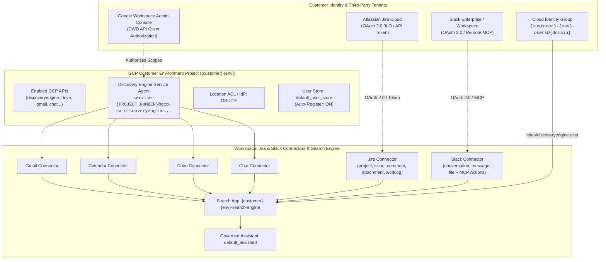
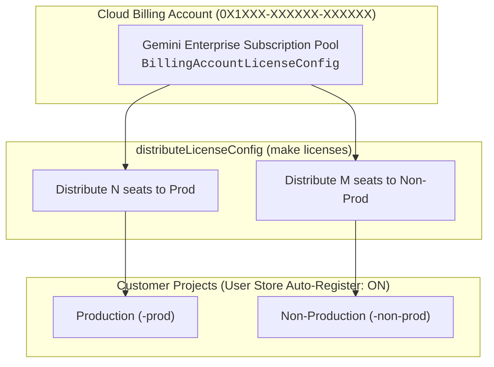

<div align="center">
  
</div>

<p align="center">
  <a href="RUNBOOK.md"></a>
  <a href="docs/CONNECTORS_ROADMAP.md"></a>
  <a href="AGENTS.md"></a>
  <a href="https://cloud.google.com/vertex-ai-search-and-conversation"></a>
  <a href="https://www.terraform.io/"></a>
  <a href="assets/prism-logo.svg"></a>
</p>

# Prism — Gemini Enterprise Customer Provisioning IaC

> **Refracting enterprise knowledge—Google Workspace, Atlassian Jira, Slack Enterprise, and Cloud Identity—into one governed Gemini Enterprise assistant.**

**Prism** is a production-grade Terraform Infrastructure as Code (IaC) and autonomous agent orchestration engine that provisions, connects, and licenses **Google Gemini Enterprise (Vertex AI Search)** across isolated customer environments (`non-prod`, `prod`, `dev`, `pilot`).

### Optical Convergence Architecture
Just as an optical prism unifies disparate wavelengths into a single beam, Prism converges six distinct enterprise data streams through five guarded deployment stages:
- **6 Enterprise Input Rays:** Gmail, Google Calendar, Google Drive, Google Chat, Atlassian Jira, and Slack Enterprise.
- **The Prism (IaC Engine):** Staged Terraform foundation, Domain-Wide Delegation (DWD), `GSUITE` location ACLs, and non-destructive plan guards (`plan_guard.py`).
- **The Gemini Apex Spark:** Unified Intranet Search Engine and Governed Enterprise Assistant (`google_discovery_engine_assistant`).

It deploys:
- **Dedicated GCP Projects** per configurable customer environment (e.g. `non-prod`, `prod`, `dev`, `pilot`).
- **Discovery Engine Service Agents** pre-created with Domain-Wide Delegation (DWD) authorization metadata.
- **Location Identity Provider (IdP)** natively configured to `GSUITE` via `google_discovery_engine_acl_config`.
- **Cloud Identity User Groups** and IAM search engine role bindings (`roles/discoveryengine.user`).
- **User Store with Auto-Registration** (`google_discovery_engine_user_store`).
- **Federated Workspace Connectors** (`google_mail`, `google_calendar`, `google_drive`, `google_chat`).
- **Atlassian Jira Data Connector** with multi-entity data stores (`project`, `issue`, `attachment`, `comment`, `worklog`) and optional Action/BAP integration.
- **Slack Enterprise Data Connector** (`slack-collection`) with real-time federated `v3` search (`conversation`, `message`, `file`), remote MCP actions (`https://mcp.slack.com`), Google-managed or BYO OAuth 2.0, and channel inclusion/exclusion privacy filters.
- **Unified Intranet Search App & Governed Assistant** (`google_discovery_engine_search_engine`, `google_discovery_engine_assistant`).
- **Automated Seat Distribution & Verification** tooling via `Makefile`.
- **Enterprise Connectors Roadmap:** Shipped Workspace, Jira, and Slack (`v1.2.0`), plus prioritized backlog for [Confluence (P1), HubSpot (P3), and People Directory (P4)](docs/CONNECTORS_ROADMAP.md).

---

## Architecture Overview



### Why Location is Global
The `location` variable defaults to `global`. In Gemini Enterprise federated Workspace search (Gmail, Calendar, Drive, Chat), queries are federated directly against Google Workspace APIs in real-time under user credentials and are not ingested or copied into GCP persistent data stores. Google Workspace connectors currently require Discovery Engine resources to reside in the `global` location.

---

## Licensing Architecture & IAM

Gemini Enterprise licenses are managed at the **Cloud Billing Account** level:



1. **Central Subscription Model**: Subscriptions are purchased on the Cloud Billing Account and distributed to project numbers via `billingAccounts.billingAccountLicenseConfigs.distributeLicenseConfig`.
2. **Auto-Registration on Login**: Projects configure `default_user_store` with `enable_license_auto_register = true`, automatically granting licenses to users upon first application login without manual seat assignments.
3. **Declarative State**: The Terraform configuration automatically emits `config/license_allocations.json` (see template in [`config/license_allocations.example.json`](config/license_allocations.example.json)), linking live GCP project numbers directly to seat quotas.
4. **Required IAM Permissions**:
   - `discoveryengine.billingAccountLicenseConfigs.distribute` on the Cloud Billing Account.
   - `roles/discoveryengine.admin` on the environment projects.
   - `roles/resourcemanager.projectViewer` on the environment projects.

---

## Prerequisites

1. **Google Cloud Platform**:
   - Active GCP Cloud Billing Account (e.g. `0X1XXX-XXXXXX-XXXXXX`).
   - Folder or Organization where customer projects will be provisioned.
   - Bootstrap / quota project (`billing_project`) with management APIs enabled:
     ```bash
     gcloud services enable \
       cloudbilling.googleapis.com \
       cloudresourcemanager.googleapis.com \
       cloudidentity.googleapis.com \
       discoveryengine.googleapis.com \
       iam.googleapis.com \
       compute.googleapis.com \
       --project=<BILLING_PROJECT_ID>
     ```
   - Terraform `v1.5+`, `gcloud`, and `python3 (>= 3.9)` installed.
   - Local authentication with a **customer Workspace domain identity**:
     ```bash
     gcloud auth application-default login
     gcloud auth login
     ```
2. **Google Workspace (Critical)**:
   - Workspace Customer ID (e.g. `C01234567`) and primary domain (`example.com`).
   - **Groups Admin Role on the `gcloud` User**: The identity authenticated in `gcloud auth application-default login` **must** hold the **Groups Admin** (or Super Admin) role in [Google Workspace Admin Console > Account > Admin roles](https://admin.google.com/ac/roles) so Terraform can provision `google_cloud_identity_group` resources.
   - **Workspace Super Administrator** access to authorize Domain-Wide Delegation at [admin.google.com/ac/owl/domainwidedelegation](https://admin.google.com/ac/owl/domainwidedelegation) using the 21-digit numeric **Client ID (`uniqueId`)** of the Discovery Engine Service Agent (`make dwd-checklist`).
3. **Gemini Enterprise Subscription**:
   - Active Gemini Enterprise subscription with allocated seat capacity on the Billing Account (discoverable via `python3 scripts/allocate_licenses.py --discover --billing-account <BILLING_ACCOUNT_ID>`).

---

## Configuration

Copy the example variables file:

```bash
cp terraform.tfvars.example terraform.tfvars
```

Edit `terraform.tfvars` with customer values:

```hcl
customer_id           = "example-customer"
customer_name         = "Example Customer"
environments          = ["non-prod", "prod"]
company_domain        = "example.com"
workspace_customer_id = "C01234567"
billing_account       = "0X1XXX-XXXXXX-XXXXXX"
folder_id             = "123456789012"

# Staged rollout flag (must be false for Stage 1)
enable_connectors     = false
workspace_connectors  = ["google_mail", "google_calendar", "google_drive", "google_chat"]

# Seat allocations per environment
seat_allocations = {
  prod     = 4
  non-prod = 1
}
```

---

## Deployment & Operational Procedure

The end-to-end staged deployment procedure is documented in:
- **[RUNBOOK.md](RUNBOOK.md)**: The authoritative step-by-step checklist and disaster prevention manual for human operators and CI systems.
- **[AGENTS.md](AGENTS.md)**: The autonomous agent operational protocol, rules of engagement, and hand-off templates.

### Quick Command Surface

All operations are executed through the standard `Makefile`:

```bash
make status            # Check live phase and identify blockers
make plan-foundation   # Stage 1: Generate foundation plan with safety guard
make apply-foundation  # Stage 1: Apply foundation infrastructure
make dwd-checklist     # Stage 2: Display Workspace DWD authorization details
make jira-checklist    # Stage 2: Display Atlassian Jira authorization details
make slack-checklist   # Stage 2: Display Slack Enterprise authorization details
make plan-connectors   # Stage 3: Generate connectors plan with safety guard
make apply-connectors  # Stage 3: Apply connectors, engines & assistants
make licenses-dryrun   # Stage 4: Verify seat distribution preflight assertions
make licenses          # Stage 4: Distribute seats to environment projects
make verify            # Stage 5: Verify health across all components
make test              # Run unit tests and Terraform validation
```

---

## File Structure

```
├── assets/
│   ├── prism-banner.svg             # 1200x320 hero vector banner
│   ├── prism-icon.svg               # 64x64 compact vector icon
│   └── prism-logo.svg               # 512x512 square vector logo
├── .agent/
│   └── workflows/
│       └── deploy.md                # Antigravity workflow
├── .github/
│   ├── ISSUE_TEMPLATE/
│   │   ├── config.yml               # Issue form metadata & runbook pointer
│   │   └── feature_request.yml      # Structured connector proposal schema
│   ├── issues/                      # Ready-to-publish feature request specs
│   │   ├── 01_confluence_connector.md # P1: Atlassian Confluence
│   │   ├── 02_slack_connector.md    # P2: Slack Enterprise Grid
│   │   ├── 03_hubspot_connector.md  # P3: HubSpot CRM
│   │   └── 04_people_directory_connector.md # P4: Google People Directory
│   └── workflows/
│       └── terraform.yml            # CI: fmt, validate, test harness
├── config/
│   ├── license_allocations.example.json # Example seat allocation schema
│   └── license_allocations.json         # Runtime allocations (gitignored)
├── docs/
│   ├── CONNECTORS_ROADMAP.md        # Prioritized connector pipeline (P1-P4)
│   └── ...                          # Supporting architecture collateral
├── scripts/
│   ├── allocate_licenses.py         # License distribution & auto-registration tool
│   ├── create_github_issues.sh      # Batch publisher for planned connector issues
│   ├── plan_guard.py                # Safety barrier preventing destroy/replace
│   ├── status.py                    # State-driven phase detection engine
│   ├── test_red.py                  # Negative & contract testing harness
│   └── verify.py                    # Post-deployment validation script
├── AGENTS.md                        # Autonomous agent operational protocol
├── GEMINI.md                        # Agent entrypoint pointer
├── Makefile                         # Unified command surface
├── README.md                        # Architecture & concept reference
├── RUNBOOK.md                       # Authoritative staged deployment runbook
├── bootstrap.sh                     # Service Account helper bootstrap
├── main.tf                          # Core Terraform resources
├── outputs.tf                       # Terraform outputs & DWD checklist
├── providers.tf                     # Google & Google-Beta providers
├── terraform.tfvars.example         # Example sanitized variable definitions
├── variables.tf                     # Input variable declarations
└── versions.tf                      # Provider & Terraform version constraints
```
