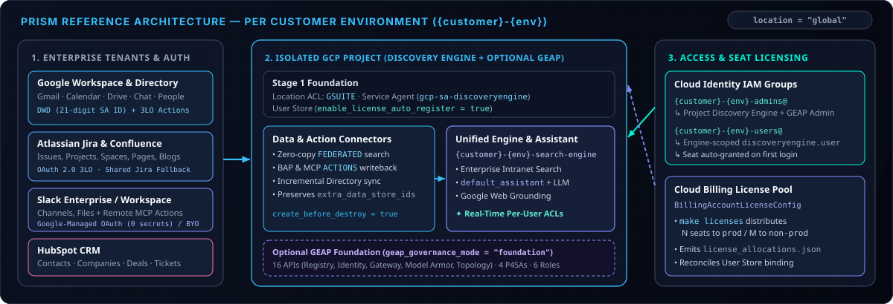
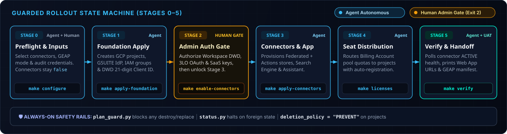
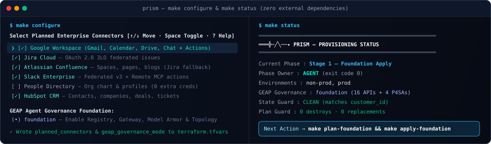

<div align="center">
  
</div>

<p align="center">
  <a href="RUNBOOK.md"></a>
  <a href="AGENTS.md"></a>
  <a href="docs/CONNECTORS_ROADMAP.md"></a>
  <a href="https://cloud.google.com/vertex-ai-search-and-conversation"></a>
  <a href="https://www.terraform.io/"></a>
</p>

# Prism — Gemini Enterprise Customer Provisioning Engine

> **Refracting 9 enterprise knowledge streams—Google Workspace, People Directory, Jira, Confluence, Slack, and HubSpot—into one governed Gemini Enterprise assistant.**

**Prism** is a Terraform Infrastructure-as-Code (IaC) and state-driven orchestration engine that provisions, connects, and licenses **Google Gemini Enterprise (Vertex AI Search)** across isolated customer environments (`non-prod`, `prod`, `dev`, `pilot`). It is built to be operated identically by **human platform engineers** (`make configure`) and **autonomous AI coding agents** ([AGENTS.md](AGENTS.md)).

<div align="center">
  
</div>

---

## What Prism Does in 30 Seconds

| Pillar | What Prism Automates |
| :--- | :--- |
| **1. Isolated Multi-Env Foundation** | Creates dedicated GCP projects per environment, configures Location ACLs to `GSUITE`, provisions Cloud Identity Admin & User groups, and pre-creates Discovery Engine Service Agents with 21-digit numeric DWD Client IDs. |
| **2. Zero-Copy Federated Search & Actions** | Connects **9 enterprise sources** in real-time `FEDERATED` mode (plus optional **BAP 3LO** & **Remote MCP `ACTIONS`**)—enforcing per-user source ACLs at query time without copying sensitive SaaS data into persistent buckets. |
| **3. Declarative Seat Licensing** | Distributes Gemini Enterprise seat quotas from the Cloud Billing Account pool to environment projects (`make licenses`) and enables User Store auto-registration on first login. |
| **4. Guarded Human + Agent Rollout** | Guides execution through a **6-phase state machine (Stages 0–5)** where [`plan_guard.py`](scripts/plan_guard.py) blocks any resource deletion/replacement and [`status.py`](scripts/status.py) halts cleanly at Human Admin OAuth/DWD gates (`exit 2`). |

---

## Reference Architecture

<div align="center">
  
</div>

> [!NOTE]
> **Why `location = "global"`?** Google Workspace federated connectors execute live queries directly against Workspace APIs under end-user identity rather than ingesting copies into regional storage, and require Discovery Engine resources in the `global` location. Supplemental customer BigQuery/GCS stores can also be attached and preserved via `extra_data_store_ids`.

<details>
<summary><strong>🛡️ Optional Day-1 Add-On: GEAP Agent Governance Foundation (<code>geap_governance_mode = "foundation"</code>)</strong></summary>
<br/>

Selectable during Stage 0 (`make configure`) or applied non-disruptively to existing deployments (`make plan-governance && make apply-governance`), **GEAP Foundation Mode** designates each customer project as an **Agent Registry Governance Project**:
- Enables **16 GEAP APIs** (Agent Registry, Agent Identity, Vertex AI Runtime/Policy, Agent Gateway, IAP, Model Armor, App Topology, and OpenTelemetry Observability).
- Pre-warms **4 Primary Google-Managed Service Agents (P4SAs)** and binds **6 GEAP Admin/Visibility IAM roles** to `{customer}-{env}-admins@{domain}`.
- Emits a Day-2 agent onboarding manifest via `make geap-checklist` with **zero deployed agents required on Day 1**.
</details>

---

## Shipped Enterprise Connectors (`v1.5`)

All Workspace and third-party SaaS connectors run in real-time **`FEDERATED`** mode (with optional write **`ACTIONS`**), keeping customer data in-place:

| Connector | Streams / Entities | Mode | Auth Architecture | Stage 2 Helper |
| :--- | :--- | :--- | :--- | :--- |
| **Google Workspace** | Gmail, Calendar, Drive, Chat | `FEDERATED` + optional `ACTIONS` | Service Agent DWD (`uniqueId`) + 3LO Web OAuth (`TF_VAR_workspace_oauth`) | `make dwd-checklist`<br/>`make workspace-actions-checklist` |
| **People Directory** | Profiles, Org Chart, Hierarchy, Schemas | `DATA_INGESTION` (Incremental) | Reuses Workspace DWD (**0 extra secrets**) | `make people-checklist` |
| **Atlassian Jira** | Projects, Issues, Comments, Attachments, Worklogs | `FEDERATED` + optional `ACTIONS` | Atlassian 3LO OAuth 2.0 (`TF_VAR_jira_auth`) | `make jira-checklist` |
| **Atlassian Confluence** | Spaces, Pages, Blogs, Attachments, Comments | `FEDERATED` + optional `ACTIONS` | 3LO OAuth 2.0 (auto-inherits shared Jira auth/URI) | `make confluence-checklist` |
| **Slack Enterprise** | Conversations, Messages, Files + Remote MCP | `FEDERATED` + `ACTIONS` (`v3`) | Google-Managed OAuth (**0 secrets**) or BYO App | `make slack-checklist` |
| **HubSpot CRM** | Contacts, Companies, Deals, Tickets | `FEDERATED` | HubSpot Service Key (`TF_VAR_hubspot_auth`) | `make hubspot-checklist` |

---

## Guarded Rollout Lifecycle (Stages 0–5)

Because Google Workspace Domain-Wide Delegation (DWD) can only be authorized *after* GCP generates each project's Discovery Engine Service Agent (`uniqueId`), Prism separates foundation creation from connector activation through an explicit **Stage 2 Human Gate**.

<div align="center">
  
</div>

| Stage | Owner | Primary Command | Outcome & Gate Condition |
| :---: | :--- | :--- | :--- |
| **0** | 🤖 Agent + 👤 Human | `make configure && make check-inputs` | Populates `terraform.tfvars`, selects `planned_connectors` & `geap_governance_mode`, audits IAM/ADC (`enable_*` stays `false`). |
| **1** | 🤖 Agent | `make plan-foundation && make apply-foundation` | Creates isolated GCP projects, `GSUITE` IdP ACLs, Cloud Identity groups, User Stores, and Service Agent DWD Client IDs. |
| **2** | 🔐 **Human Gate** | `make dwd-checklist` → `make enable-connectors` | Admins authorize Workspace DWD & SaaS OAuth/keys (`status.py` exits `2` until `make enable-connectors` validates & unlocks Stage 3). |
| **3** | 🤖 Agent | `make plan-connectors && make apply-connectors` | Provisions federated/action connectors, flattens data stores into the Unified Search Engine, and configures `default_assistant`. |
| **4** | 🤖 Agent *(Gate if no sub)* | `make licenses-dryrun && make licenses` | Distributes Cloud Billing subscription seats across environment projects and binds User Store license configs. |
| **5** | 🤖 Agent → 👤 UAT | `make verify` | Polls until all connectors & engines reach `ACTIVE`, outputs Web App URLs, and hands off for pilot group UAT. |

> [!IMPORTANT]
> **Where to go deeper:** This README covers architecture and happy-path operation. For per-stage preconditions, exact 12-scope DWD CSV strings, OAuth callback URIs, and error recovery playbooks, see **[RUNBOOK.md](RUNBOOK.md)**. For autonomous agent rules and hand-off templates, see **[AGENTS.md](AGENTS.md)**.

---

## Quickstart

### 1. Prerequisites
1. **GCP:** Active Cloud Billing Account, target Organization or Folder, Terraform `>= 1.5`, `gcloud`, and `python3 >= 3.9`.
2. **Identity (`gcloud auth login` & `application-default login`):** Authenticate as a customer Workspace domain user holding GCP `projectCreator` + `billing.user` **and** Google Workspace **Groups Admin** (to create Cloud Identity groups). A **Workspace Super Admin** is required at Stage 2 for DWD.
3. **Subscription:** Active Gemini Enterprise seat pool on the Billing Account (discoverable via `python3 scripts/allocate_licenses.py --discover`).

### 2. Configure & Audit Inputs (Stage 0)

Run the zero-dependency interactive terminal wizard (or copy [`terraform.tfvars.example`](terraform.tfvars.example) to `terraform.tfvars`):

<div align="center">
  
</div>

```bash
make configure      # Interactive arrow-key selector for connectors, Workspace Actions & GEAP
make check-inputs   # Audits missing/placeholder variables with console URLs & lookup commands
make status         # Prints live stage, owner (AGENT vs HUMAN), and exact next command
```

Minimal `terraform.tfvars` footprint:

```hcl
customer_id           = "acme"
customer_name         = "Acme Corp"
environments          = ["non-prod", "prod"]
company_domain        = "acme.com"
workspace_customer_id = "C01234567"
billing_account       = "0X1XXX-XXXXXX-XXXXXX"
folder_id             = "123456789012"

planned_connectors    = ["workspace", "jira", "confluence", "slack"]
geap_governance_mode  = "foundation" # or "none"
enable_connectors     = false        # Flipped automatically in Stage 2 via `make enable-connectors`

seat_allocations = {
  prod     = 50
  non-prod = 5
}
```

### 3. Command Reference (`Makefile`)

```bash
# ── Day-1 Staged Rollout ──────────────────────────────────────────────────────
make status                                   # Live phase detection & blocker check
make plan-foundation && make apply-foundation # Stage 1: Projects, GSUITE IdP, IAM & DWD IDs
make enable-connectors                        # Stage 2: Validate Admin gates & unlock Stage 3
make plan-connectors && make apply-connectors # Stage 3: Connectors, Search Engine & Assistant
make licenses-dryrun && make licenses         # Stage 4: Distribute Billing Account seats
make verify WAIT=15m                          # Stage 5: Poll until ACTIVE & print Web App URLs

# ── Stage 2 Admin Checklists & Day-2 Operations ───────────────────────────────
make dwd-checklist               # Print 21-digit numeric Client ID & 12-scope CSV
make workspace-actions-checklist # Print 3LO Web OAuth redirect URIs for Workspace Actions
make jira-checklist              # Print Atlassian Jira 3LO callback URL, scopes & cloudId
make confluence-checklist        # Print Confluence 3LO setup (or shared Jira fallback)
make slack-checklist             # Print Slack v3 Federated + MCP setup
make hubspot-checklist           # Print HubSpot CRM Service Key scopes & entities
make people-checklist            # Print Google People Directory DWD verification
make plan-governance             # Guarded GEAP-only plan for existing Stage 3–5 deployments
make apply-governance            # Apply GEAP Foundation without touching running connectors
make geap-checklist              # Print Agent Registry & Day-2 governance handoff manifest
make test                        # Run contract tests (test_red.py), fmt & terraform validate
```

---

## Repository Map

```text
├── assets/                  # Brand identity SVGs, architecture/lifecycle diagrams & optical hero art
├── config/                  # Declarative seat allocation template & Terraform-emitted runtime mapping
├── docs/                    # Enterprise connectors release matrix (CONNECTORS_ROADMAP.md)
├── scripts/
│   ├── status.py            # Live Stage 0–5 state machine & admin checklist renderer
│   ├── configure.py         # Zero-dependency TTY/JSON onboarding wizard & Stage 2 gate validator
│   ├── plan_guard.py        # Non-destructive .tfplan barrier (refuses deletes/replacements)
│   ├── allocate_licenses.py # Cloud Billing seat discovery, distribution & User Store binding
│   ├── verify.py            # End-to-end connector & engine ACTIVE health verifier
│   └── test_red.py          # Negative, safety-rail & contract test suite
├── AGENTS.md                # Autonomous agent operational protocol & human gate hand-off templates
├── Makefile                 # Unified operator & agent command surface
├── RUNBOOK.md               # Authoritative Stage 0–5 manual, OAuth scopes & recovery playbooks
├── main.tf                  # Core multi-environment GCP, Identity, Connector, Engine & GEAP IaC
├── variables.tf             # Typed input declarations & validation constraints
├── outputs.tf               # Environment project IDs, console URLs & DWD metadata outputs
└── terraform.tfvars.example # Reference customer configuration template
```
