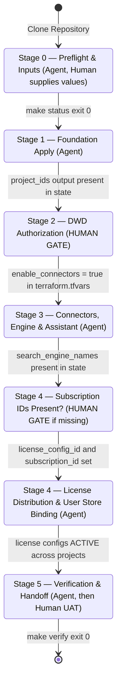

# Prism — Gemini Enterprise Provisioning Runbook

This runbook defines the authoritative, staged procedure for **Prism**: provisioning Gemini Enterprise (Vertex AI Search) with Google Workspace, Atlassian Jira, and Slack Enterprise connectors across customer environments.

It serves both **human operators** and **autonomous AI agents** ([AGENTS.md](AGENTS.md)). Every stage contains machine-checkable preconditions, execution targets via `make`, success criteria, failure handling, and checklist items.

---

## Deployment Lifecycle & State Machine



---

## State Safety & Disaster Prevention

> [!CAUTION]
> **State Mismatch Protection:** If a local `terraform.tfstate` exists containing `google_project` resources whose `project_id` does not match the customer identifier `${project_id_prefix}${customer_id}-<env>`, running `terraform apply` will destroy those existing projects.
> `scripts/status.py` and `scripts/plan_guard.py` automatically detect state mismatches and refuse plan/apply actions. Never bypass this check by editing `.tf` files or force-applying.

---

## Stage 0 — Preflight & Inputs

**Owner:** Agent (Human supplies customer values)

**Preconditions (machine-checkable):**
- Tools check: `terraform version` (>= 1.5.0), `gcloud --version`, `python3 --version` (>= 3.9).
- Identity check: `gcloud auth application-default print-access-token` returns a valid token for a **customer Workspace domain user** who holds:
  - GCP IAM roles: `roles/resourcemanager.projectCreator` and `roles/billing.user`.
  - Google Workspace Admin role: **Groups Admin** (or Super Admin) in [Workspace Admin Console > Admin roles](https://admin.google.com/ac/roles) (required to create `google_cloud_identity_group`).

**Do:**
1. Check live status:
   ```bash
   make status
   ```
2. If `terraform.tfvars` does not exist, copy from template:
   ```bash
   cp terraform.tfvars.example terraform.tfvars
   ```
3. Populate required customer values in `terraform.tfvars`:
   - `customer_id`: Unique slug (e.g. `acme`).
   - `customer_name`: Full display name (e.g. `Acme Corporation`).
   - `company_domain`: Primary Google Workspace domain (e.g. `acme.com`).
   - `workspace_customer_id`: Google Workspace Customer ID (e.g. `C01234567`).
   - `billing_account`: GCP Billing Account ID (e.g. `012345-6789AB-CDEF01`).
   - `folder_id` or `org_id`: Resource hierarchy destination.
   - `enable_connectors = false` (must remain `false` for initial Foundation apply).
4. Run Terraform validation:
   ```bash
   terraform init
   terraform validate
   ```

**Done when:**
- `make status` returns exit code 0 and indicates readiness for Stage 1.

**If it fails:**
- Missing CLI tools: Install required packages (`terraform`, `gcloud`, `python3`).
- Authentication failure: Escalate using the **identity** template; run `gcloud auth application-default login` and `gcloud auth login`.
- State mismatch detected: Escalate using the **state_mismatch** template. Reconcile or back up foreign state before proceeding.

**Checklist:**
- [ ] Required tools verified in PATH
- [ ] Active GCP account authenticated with Workspace **Groups Admin** rights
- [ ] `terraform.tfvars` populated with non-placeholder values
- [ ] Initial `terraform init` and `terraform validate` pass

---

## Stage 1 — Foundation Infrastructure Apply

**Owner:** Agent

**Preconditions (machine-checkable):**
- `make status` returns exit code 0 (`phase: 1, phase_name: "foundation_apply"`).
- `enable_connectors` is `false` in `terraform.tfvars`.

**Do:**
1. Generate and guard the foundation plan:
   ```bash
   make plan-foundation
   ```
2. Apply the guarded plan:
   ```bash
   make apply-foundation
   ```

**Done when:**
- `terraform output -json project_ids` contains all configured environments.
- `config/license_allocations.json` is automatically generated by Terraform.
- Re-plan produces zero diff (`make status` exits with code 2, signalling Stage 2 gate).

**If it fails:**
- `plan_guard` stops on deletions: Check why existing resources would be modified. Do not set `ALLOW_DESTROY=1` unless destruction is intended.
- `google_cloud_identity_group` 403 Forbidden: Provisioner principal lacks Groups Admin role in Google Workspace Admin Console. Escalate using **permissions** template.
- Project creation quota / billing link failure: Escalate to GCP organization billing admin.

**Checklist:**
- [ ] `make plan-foundation` generated `.plans/foundation.tfplan` with 0 deletes/replaces
- [ ] Foundation resources successfully applied across all environments
- [ ] Discovery Engine service agent identities created (`service-<PROJECT_NUMBER>@gcp-sa-discoveryengine.iam.gserviceaccount.com`)
- [ ] Cloud Identity User Groups created (`<customer_id>-<env>-users@<domain>`)
- [ ] Location IdP configured to `GSUITE`

---

## Stage 2 — Workspace, Atlassian Jira & Slack Authorization Gate

**Owner:** Human (Workspace Super Admin, Atlassian Admin & Slack Admin Gate)

**Preconditions (machine-checkable):**
- `make status` returns exit code 2 (`phase: 2`, `phase_name: "dwd_authorization"`, `"jira_authorization"`, or `"slack_authorization"`).
- Foundation projects and Discovery Engine service agents exist.

**Do:**
1. Retrieve the authorization parameters (including the **21-digit numeric `client_id`**):
   ```bash
   make dwd-checklist
   ```
   > **Where does the 21-digit numeric Client ID come from?**
   > `service-<PROJECT_NUMBER>@gcp-sa-discoveryengine.iam.gserviceaccount.com` is a Google-managed Service Agent and does not appear in the standard Cloud Console *Service Accounts* list. `make dwd-checklist` automatically resolves its 21-digit numeric OAuth2 `uniqueId` via the Service Usage API (`POST https://serviceusage.googleapis.com/v1beta1/projects/<PROJECT_NUMBER>/services/discoveryengine.googleapis.com:generateServiceIdentity`).
2. Open the [Google Workspace Admin Console - Domain-Wide Delegation](https://admin.google.com/ac/owl/domainwidedelegation).
3. Click **Add new** API client for each environment project:
   - **Client ID**: The 21-digit numeric `client_id` (`uniqueId`) or `service_agent_email` from `make dwd-checklist`.
   - **OAuth Scopes**: Copy and paste the comma-separated scope string from `dwd-checklist`:
     ```
     https://www.googleapis.com/auth/admin.directory.user.readonly,https://www.googleapis.com/auth/admin.directory.group.readonly,https://www.googleapis.com/auth/admin.directory.group.member.readonly,https://www.googleapis.com/auth/gmail.readonly,https://www.googleapis.com/auth/calendar.readonly,https://www.googleapis.com/auth/drive.readonly,https://www.googleapis.com/auth/chat.spaces.readonly,https://www.googleapis.com/auth/chat.messages.readonly,https://www.googleapis.com/auth/chat.memberships.readonly
     ```
   - Click **Authorize**.
4. In Workspace Admin Console under **Security > Access and data control > API controls > Google Cloud Core Services**, allow access for the environment GCP project IDs if prompted.
5. If Atlassian Jira is enabled (`enable_jira_connector = true`):
   - Run `make jira-checklist` to view the Jira instance URI, resolved `cloudId` (`instance_id`), required OAuth scopes, and redirect URLs.
   - For OAuth 2.0 (3LO, v3): Register app in [Atlassian Developer Console](https://developer.atlassian.com/console/myapps/) with callback URLs `https://vertexaisearch.cloud.google.com/console/oauth/jira_oauth.html` (Ingestion) and `https://vertexaisearch.cloud.google.com/oauth-redirect` (Actions), configure scopes from `jira-checklist`, and export credentials via `export TF_VAR_jira_auth='{"client_id":"...","client_secret":"...","refresh_token":"...","instance_id":"..."}'`.
   - For API Token (Basic Auth, v1): Generate API token in Atlassian account security settings and export via `export TF_VAR_jira_auth='{"user_account":"...","api_token":"..."}'`.
   - Update `jira_config.instance_uri` (and optionally `jira_config.instance_id`) in `terraform.tfvars`.
6. If Slack Enterprise is enabled (`enable_slack_connector = true`):
   - Run `make slack-checklist` to view the Slack workspace URI, `team_id`, OAuth callback URL (`https://vertexaisearch.cloud.google.com/oauth-redirect`), target federated entities (`conversation`, `message`, `file`), and scopes.
   - **Option A — Default Google-Managed OAuth (`slack_auth_type = "OAUTH"`, `v3` Federated + Actions):** No `TF_VAR_slack_auth` secret is required; set `slack_config.instance_uri` (e.g. `https://your-workspace.slack.com`) and `slack_config.team_id` (`T...` or `E...`) in `terraform.tfvars`. End users authorize Slack directly via **Sources → Connect** in the Gemini Enterprise Web App.
   - **Option B — Custom BYO Slack OAuth App (`slack_auth_type = "OAUTH"`):** Create a Slack App at [api.slack.com/apps](https://api.slack.com/apps) with redirect URL `https://vertexaisearch.cloud.google.com/oauth-redirect`, configure scopes from `make slack-checklist`, and export `export TF_VAR_slack_auth='{"client_id":"...","client_secret":"...","team_id":"T01234567"}'`.
7. Signal completion by updating `terraform.tfvars` (if deploying Workspace connectors):
   ```hcl
   enable_connectors = true
   ```

**Done when:**
- `enable_connectors = true` is set in `terraform.tfvars` (or Jira-only / Slack-only connector mode is enabled).
- If `enable_jira_connector = true`, `jira_config.instance_uri` is non-empty and non-placeholder.
- If `enable_slack_connector = true`, `slack_config.instance_uri` and `slack_config.team_id` are non-empty and non-placeholder.
- `make status` returns exit code 0 (`phase: 3, phase_name: "connectors_and_engines_apply"`).

**If it fails:**
- DWD authorization rejected by Admin Console: Verify executing human is a Workspace Super Admin and use the 21-digit numeric `client_id` from `make dwd-checklist`.
- Incomplete scopes: Ensure all 9 required scopes are pasted without trailing spaces.
- Jira OAuth/Token rejection: Verify Atlassian 3LO app redirect URI and scopes match `make jira-checklist`, and credentials in `TF_VAR_jira_auth` have access to the target Jira Cloud instance.
- Slack OAuth/Bot rejection: Verify `slack_config.instance_uri` and `slack_config.team_id` match the target workspace, and (if using BYO OAuth) verify `TF_VAR_slack_auth` `client_id` / `client_secret` and redirect URL match `make slack-checklist`.

**Checklist:**
- [ ] Retrieved 21-digit numeric `client_id`, service agent email, and scope CSV via `make dwd-checklist`
- [ ] Authorized DWD client for each environment in Google Workspace Admin Console
- [ ] Allowed GCP projects under Google Cloud Core Services
- [ ] Configured Jira OAuth app / API token via `make jira-checklist` (if Jira enabled)
- [ ] Configured Slack workspace URI / `team_id` (and optional BYO OAuth app) via `make slack-checklist` (if Slack enabled)
- [ ] Flipped `enable_connectors = true` in `terraform.tfvars` (when deploying Workspace connectors)

---

## Stage 3 — Workspace, Jira & Slack Connectors, Search Engines & Assistants

**Owner:** Agent (after Stage 2 Human Gate)

**Preconditions (machine-checkable):**
- `make status` returns exit code 0 (`phase: 3, phase_name: "connectors_and_engines_apply"`).
- `enable_connectors` is `true` in `terraform.tfvars` (or `enable_jira_connector` / `enable_slack_connector` is `true` with valid configuration).

**Do:**
1. Generate and guard the connectors plan:
   ```bash
   make plan-connectors
   ```
2. Apply the guarded plan:
   ```bash
   make apply-connectors
   ```

**Done when:**
- `terraform output -json search_engine_names` contains all configured environments.
- `terraform output -json assistant_names` contains all configured environments.
- All provisioned connectors (Workspace, Jira, and/or Slack) exist in state.
- Re-plan produces zero diff.

**If it fails:**
- Connector creation fails with `PERMISSION_DENIED` or `unauthorized_client`: Domain-Wide Delegation OAuth tokens can take up to 5–15 minutes to propagate. Wait 5 minutes and retry `make apply-connectors`.
- Jira connector fails with authentication/network error: Verify Jira instance URI is reachable, allowlist static IPs if enabled, and verify `TF_VAR_jira_auth`.
- Slack connector fails with `INITIALIZING` state update error or `400`: Wait for initial BAP connection provisioning to reach `ACTIVE`, and ensure `entities` uses `["conversation", "message", "file"]`.
- If permission failure persists after 15 minutes: Escalate with the **dwd**, **jira**, or **slack** template to re-verify credentials and scope entries.
- `google_discovery_engine_assistant.default` fails with `400` / `409` (`Only one assistant per engine is allowed` / `Already Exists`): Provisioning a search engine with `SEARCH_ADD_ON_LLM` automatically creates `default_assistant`. Import it into state (`terraform import 'google_discovery_engine_assistant.default["<env>"]' projects/<PROJECT_ID>/locations/global/collections/default_collection/engines/<ENGINE_ID>/assistants/default_assistant`) and re-run `make plan-connectors && make apply-connectors`.

**Checklist:**
- [ ] `make plan-connectors` generated `.plans/connectors.tfplan` with 0 deletes/replaces
- [ ] Workspace data connectors provisioned (`google_mail`, `google_calendar`, `google_drive`, `google_chat`)
- [ ] Atlassian Jira connector provisioned with multi-entity data stores (if enabled)
- [ ] Slack Enterprise federated connector provisioned with `conversation`, `message`, and `file` data stores (if enabled)
- [ ] Unified Search Engine provisioned for each environment with flattened connector data stores
- [ ] Governed Gemini Enterprise Assistant provisioned with web grounding
- [ ] Engine-scoped IAM permissions granted to User Cloud Identity Groups

---

## Stage 4 — License Seat Distribution & User Store Binding

**Owner:** Agent (Human gate only if subscription IDs are missing)

**Preconditions (machine-checkable):**
- `license_config_id` and `subscription_id` in `terraform.tfvars` are populated with active billing subscription IDs. (If only the subscription name is visible in Cloud Console, run `python3 scripts/allocate_licenses.py --discover` to look up both UUIDs from the Billing Account.)
- `make status` returns exit code 0 (`phase: 4, phase_name: "license_distribution"`).

**Do:**
1. *(Optional)* Auto-discover active subscription and `license_config_id` from the Billing Account:
   ```bash
   python3 scripts/allocate_licenses.py --discover
   ```
2. Perform preflight checks and dry-run distribution:
   ```bash
   make licenses-dryrun
   ```
3. Execute seat distribution from Cloud Billing Account pool to environment projects:
   ```bash
   make licenses
   ```
4. List active project license configurations:
   ```bash
   make licenses-list
   ```
5. **Close the declarative loop:** Emit the distributed license configuration names and add them to `terraform.tfvars`:
   ```bash
   python3 scripts/allocate_licenses.py --emit-tfvars
   ```
   Add the generated `license_config_names = { ... }` block to `terraform.tfvars` and run `make plan-connectors && make apply-connectors` to ensure `google_discovery_engine_user_store.default_license_config` is drift-free and managed by Terraform.

**Done when:**
- `make licenses-list` shows `ACTIVE` state with the expected seat allocations for each environment.
- `make status` returns exit code 0 (`phase: 5, phase_name: "verification"`).

**If it fails:**
- Missing subscription IDs: Run `python3 scripts/allocate_licenses.py --discover`. If no active subscription exists on the Billing Account, `make status` exits with code 2; escalate with the **subscription** template.
- Project number mismatch: Preflight assertions fail loudly. Verify that `config/license_allocations.json` project numbers match Cloud Resource Manager metadata.
- Insufficient pool capacity: Billing account pool lacks free seats. Increase capacity in Google Cloud Console or reduce `seat_allocations`.

**Checklist:**
- [ ] `make licenses-dryrun` passed preflight project verification and capacity checks
- [ ] `make licenses` successfully distributed seats across environment projects
- [ ] `license_config_names` added to `terraform.tfvars` and reconciled via `terraform apply`

---

## Stage 5 — Verification & End-User Handoff

**Owner:** Agent, then Human (User Acceptance Testing)

**Preconditions (machine-checkable):**
- `make status` returns exit code 0 (`phase: 5, phase_name: "verification"`).

**Do:**
1. Run end-to-end verification (polls with timeout for connectors to transition to `ACTIVE`):
   ```bash
   make verify WAIT=15m
   ```
2. Review the printed summary table and Vertex AI Search console URLs.
3. Conduct User Acceptance Testing (Human):
   - Add pilot users to the provisioned Cloud Identity User Group (`<customer_id>-<env>-users@<domain>`).
   - Allow **1–3 minutes** for Cloud Identity group membership and User Store license auto-assignment to propagate.
   - Open the Vertex AI Search application console in an Incognito browser window.
   - If Slack Enterprise (or another 3rd-party federated connector) is enabled, open **Sources** in the Web App prompt bar and click **Connect** once to authorize your user account, then start a **New chat**.
   - Verify search queries across Gmail, Calendar, Drive, Chat, Jira, and Slack.
   - Verify Gemini Enterprise Assistant answers and web grounding.

**Done when:**
- `make verify` exits with code 0 (all components report `ACTIVE`).
- Pilot users can log in and execute search queries successfully.

**If it fails:**
- Connectors stuck in `INITIALIZING`: Allow up to 15–30 minutes for initial Workspace connector federation handshakes.
- User login denied or license not yet assigned: Wait 1–3 minutes for group membership propagation, and verify user store auto-registration is `true`.

**Checklist:**
- [ ] `make verify` passes with all components `ACTIVE`
- [ ] Console URLs confirmed accessible
- [ ] Pilot users granted access via Cloud Identity group
- [ ] End-to-end user search verification completed
